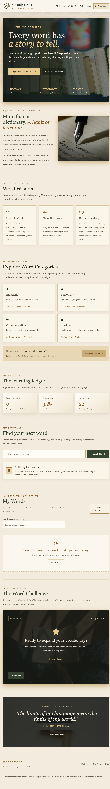
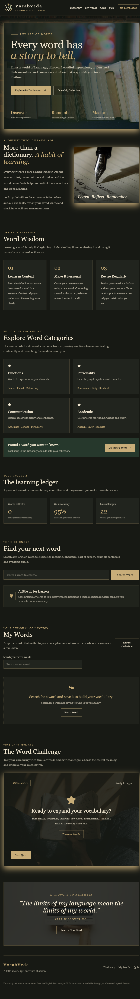

# VocabVeda | The Art of Words

## Description

VocabVeda is a vocabulary-building website designed to help users improve their English vocabulary. Users can search for word meanings, save favourite words, practise through quizzes, and track their learning progress.

The website is built using HTML, Tailwind CSS, and Vanilla JavaScript.

## Features

- Search English words and view their definitions.
- Explore vocabulary and discover new words.
- Save favourite words for future revision.
- Practise vocabulary through interactive quizzes.
- Track learning progress and quiz accuracy.
- Switch between light and dark themes.
- Use a responsive interface on desktop and mobile devices.
- View pronunciation information where available.

## API Used

**English Wiktionary REST API**

- **API endpoint:** https://en.wiktionary.org/api/rest_v1/page/definition/

The website uses this API endpoint in `script.js` to retrieve definitions for searched words. The searched word is appended to the endpoint dynamically.

## Screenshots

### Light Mode

### Dark Mode

## Technologies Used

- HTML5
- Tailwind CSS
- Vanilla JavaScript
- Fetch API with async/await
- LocalStorage

## Project Structure

VocabVeda/
├── images/
├── screenshots/
│   ├── light-mode.png
│   └── dark-mode.png
├── index.html
├── script.js
└── README.md

## Live Website

The live website link will be added after deployment.
